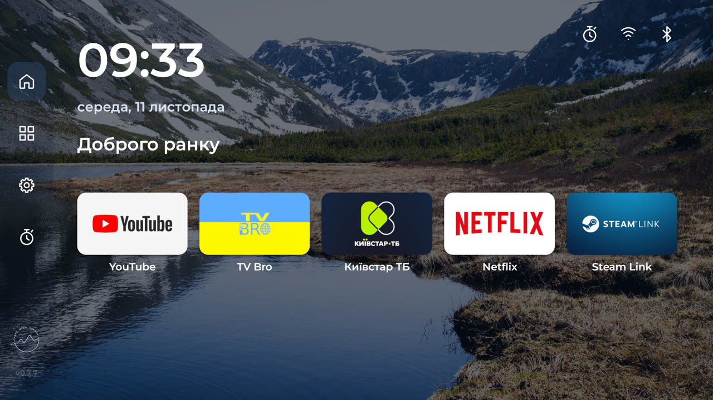

# Carpe TV — Android TV & Google TV Launcher

**Public APK in preparation.** This source does not yet have a signed public release.

Carpe TV is a lightweight home screen for your TV or streaming stick. Keep favorite
apps close, search your app library and navigate with a remote. No launcher account required.

**English** · [Українська](README.md)

[Releases & APKs](https://github.com/carpe-diem-agency/carpe-tv-launcher/releases) ·
[Installation](docs/INSTALL.md) · [Updates](docs/UPDATING.md) · [Changelog](CHANGELOG.md)

[Quick install](docs/QUICKSTART.en.md)



## Why Carpe TV

Stock home screens vary by manufacturer and may devote much of the screen to
recommendations. Carpe TV centers your chosen apps on Home; the rest live in
a searchable library. You can choose the wallpaper, screensaver and favorite
app order.

| | Typical stock home screen | Carpe TV |
| --- | --- | --- |
| Home | Content varies by manufacturer | Your chosen apps |
| All apps | Placement varies by firmware | One searchable library |
| Appearance | Options vary by firmware | Wallpaper and screensaver choices |

This compares features, not measured speed; stock launchers vary.
[See the visual comparison](docs/index.html#compare-title-en).

Basic installation takes one APK. Android confirms installation; no root,
computer or Carpe TV account is required. The stock launcher stays installed,
and Android settings let you change the Home choice back. Some firmware may
ignore that choice, so check the physical Home button before changing anything
else. [Install and rollback steps](docs/INSTALL.md).

## Features

- Favorite apps on Home, with selection and reordering.
- Searchable app library with a cached app list.
- Remote navigation and animated focus.
- Appearance settings, Ukrainian and English.
- Background update downloads; installation is confirmed by the user.
- Open Android's Home chooser and return to the stock launcher.

**Also included:** rotating wallpapers, a built-in screensaver with a bounded cache,
Apps & background controls and a sleep timer with a `mm:ss` countdown.
System changes and the timer require Shizuku; the basic launcher works without it.

## Minimum requirements

| Item | Requirement |
| --- | --- |
| System | Android TV / Google TV running Android **8.0+ (API 26)** |
| Controls | A remote with directional buttons, OK and Back |
| Installation | Permission to install an APK from an approved source |
| Network | Needed for update downloads and online screensavers; local apps launch without it |

A minimum RAM or storage threshold has not been measured separately. The tested
Stick has about **2 GB RAM**. We recommend at least **100 MB of free storage** for
the launcher and APK downloads; screensavers need additional headroom. This is a
recommendation, not a validated lower limit. Root is not required for ordinary use.

The Android version alone does not guarantee Home or system-control compatibility on every firmware.

## Tested devices

Only devices we have tested directly are listed. We will expand this table as testing progresses.

| Device | Android model | OS | Last tested |
| --- | --- | --- | --- |
| Xiaomi TV Stick | `MiTV-AFMU1` (`twilight`) | **Android TV 14** | 2026-11-11 · Carpe TV 0.2.7, code 14 |

Firmware: `UKG3.250826.001.V816.0.7.0.UZFAATK`. The UI was tested at **1920×1080**;
4K HDMI output does not imply a 4K launcher render. Other models and Stick generations are untested.
[Results and limitations](docs/VALIDATION.md#system-controls--xiaomi-tv-stick-2026-11-03).

**Home support on Xiaomi is not yet confirmed for the public APK:** choosing Carpe TV
as Home and pressing Home were tested through ADB, but the physical remote and reboot
still need testing. Do not disable the Google TV package on this firmware: it can
open the recovery screen. Use Android's Home app selection to switch launchers.

## Install and update

A short [TV and phone install page](docs/index.html) is prepared; its GitHub
Pages URL will become live after the first public stable release.

1. Once the signed build is published, open the [latest release](https://github.com/carpe-diem-agency/carpe-tv-launcher/releases/latest)
   on the TV and download `carpe-tv.apk`. If the TV has no browser, transfer
   the same file from your phone. Android confirms the APK installation.
2. Open Carpe TV and check app launching and remote navigation. The first launch offers
   a direct path to Android's Home picker or a chance to explore first.
3. To use it for Home, select Carpe TV in Android's Home picker and check it with
   the physical remote. Some firmware may ignore this choice; switch back to
   the stock launcher on those devices. The public build has no Accessibility
   service to intercept Home.
4. Keep the stock launcher available for recovery.

[Step-by-step installation and rollback](docs/INSTALL.md).

Updates: **Settings → About → Updates**. Download in the background, then confirm
installation in Android. On the first update, allow **Install unknown apps only for
Carpe TV**, return and select Install again.
[Illustrated update guide](docs/UPDATING.md).

The update feed is prepared and becomes usable after the first public stable release.
Compatible updates preserve settings; an APK with a different signature cannot update
the installed app.

## Apps & background and sleep timer

These features are in the current source; no public APK containing them has been released yet.

- **Xiaomi Analytics:** select the app → Disable analytics → read the warning →
  Continue. Restore it from the same menu. Shizuku system access is required.
- **Return to stock Home:** if it is enabled, choose another launcher without
  Shizuku. On Xiaomi, the separate **Enable Google TV and choose Home** action
  needs Shizuku. [Full instructions and ADB recovery](docs/INSTALL.md#return-to-the-stock-launcher).
- **Sleep timer:** stopwatch in the side rail → 15–120 minutes. Remaining time
  appears below it; cancel from the timer dialog. Requires running Shizuku and, on
  Android 12+, Alarms & reminders permission. Works while other apps are open.
  Reboot cancels the timer; set it again after force-stop or permission revocation.
  This sleeps the stick, not necessarily the TV or projector.
- **Sleep now:** the power icon at the top sleeps the stick after confirmation.
  It needs running Shizuku and does not cut power to the device.

Restart Shizuku after a reboot before making new system changes. Disabled analytics
stays disabled. Carpe TV does not stop apps automatically; Enabled does not mean
an app is currently running in the background.

## For developers

Java and Android XML Views. Build with **JDK 17**, Android SDK Platform 34 and
Build Tools 36.0.0. Set `ANDROID_HOME` or use a local `local.properties`.

```sh
./gradlew --no-daemon assembleDebug assembleDebugAndroidTest assembleRelease lintDebug
python3 scripts/check_repository.py
```

Debug APK: `app/build/outputs/apk/debug/app-debug.apk`. The first build downloads
Gradle 9.8.2 and AGP 9.5.0. Release signing must be configured separately.

[Architecture & permissions](docs/ARCHITECTURE.md) · [Design](docs/DESIGN.md) ·
[Validation](docs/VALIDATION.md) · [Signing & releases](docs/RELEASING.md) ·
[Update channel](docs/UPDATES.md) · [Roadmap](docs/ROADMAP.md) · [Publication checklist](docs/PUBLICATION.md)

## License and privacy

The original source code is licensed under [Apache-2.0](LICENSE). Fonts, photos,
libraries and third-party marks retain their own terms; see [NOTICE](NOTICE).
Montserrat uses OFL; Shizuku API uses MIT. [Asset notices](THIRD_PARTY_NOTICES.md) · [CC0 photo sources](docs/wallpapers/README.md).

Personal data, signing keys and device dumps are not tracked. The launcher does not
request camera, microphone, location or broad storage access. An APK backup is not
a complete backup of the system or private app data.

Developed by [Carpe Diem Agency](https://carpediem.agency).
