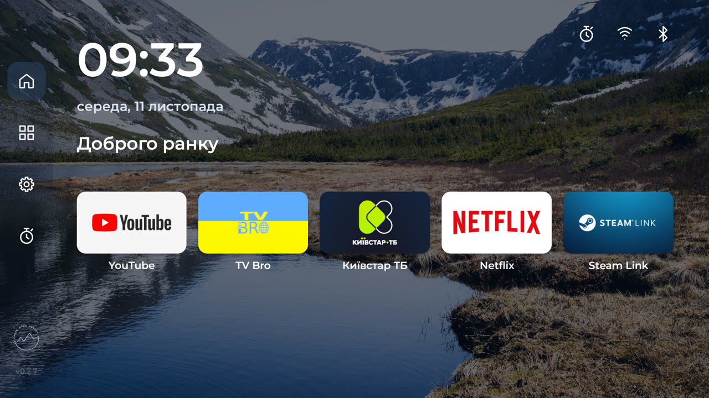

# Carpe TV — лаунчер для Android TV та Google TV

**Публічний APK готується.** Поточний вихідний код ще не має підписаного
публічного релізу.

Carpe TV — легкий домашній екран для телевізора чи приставки. Улюблені програми,
бібліотека з пошуком і керування пультом. Без обов’язкового акаунта.

[English](README.en.md) · **Українська**

[Релізи та APK](https://github.com/carpe-diem-agency/carpe-tv-launcher/releases) ·
[Встановлення](docs/INSTALL.uk.md) · [Оновлення](docs/UPDATING.uk.md) · [Історія змін](CHANGELOG.md)

[Коротка інструкція](docs/QUICKSTART.uk.md)



## Чому Carpe TV

Штатні екрани різняться між виробниками й можуть віддавати багато місця
рекомендаціям. Carpe TV зосереджується на ваших обраних програмах: вони
відкриваються з головного екрана, а решта є в бібліотеці з пошуком. Фон,
заставку та порядок обраного можна налаштувати.

| | Типовий штатний екран | Carpe TV |
| --- | --- | --- |
| Головний екран | Наповнення залежить від виробника | Ваші обрані програми |
| Усі програми | Розташування залежить від прошивки | Одна бібліотека з пошуком |
| Вигляд | Налаштування залежать від прошивки | Вибір фону та заставки |

Це порівняння можливостей, а не вимір швидкості: штатні лаунчери відрізняються.
[Подивитися візуальне порівняння](docs/index.html#compare-title-uk).

Для базового встановлення потрібен один APK. Android показує системне
підтвердження встановлення; root, комп’ютер і акаунт Carpe TV не потрібні.
Штатний лаунчер залишається встановленим, а вибір Home можна повернути через
налаштування Android. На окремих прошивках Home може ігнорувати вибір —
перевірте його фізичним пультом перед подальшими змінами. [Кроки встановлення
й відкату](docs/INSTALL.uk.md).

## Можливості

- Улюблені програми на головній, їх вибір і впорядкування.
- Бібліотека з пошуком і кешованим списком програм.
- Керування пультом та анімований фокус.
- Налаштування вигляду, українська та англійська мови.
- Завантаження оновлень у фоні; встановлення підтверджує користувач.
- Перехід до системного вибору Home та повернення до штатного лаунчера.

**Також є:** динамічні шпалери, власна заставка з обмеженим кешем,
розділ «Програми й фон» і таймер сну з відліком `хв:сек`.
Системні зміни й таймер потребують Shizuku; базовий лаунчер працює без нього.

## Мінімальні вимоги

| Що потрібно | Вимога |
| --- | --- |
| Система | Android TV / Google TV на Android **8.0+ (API 26)** |
| Керування | Пульт із напрямками, OK та «Назад» |
| Встановлення | Можливість встановлювати APK із дозволеного джерела |
| Мережа | Для завантаження оновлень і онлайн-заставок; локальні програми запускаються без неї |

Мінімальний обсяг ОЗП і місця окремо не визначений. Перевірений стік має близько
**2 ГБ ОЗП**. Рекомендуємо залишати щонайменше **100 МБ вільного місця** для
лаунчера й завантаження APK; заставкам потрібен додатковий запас. Це рекомендація,
а не перевірений нижній поріг. Root для звичайного використання не потрібен.

Версія Android сама по собі не гарантує сумісності Home або системних дій на кожній прошивці.

## Де перевірено

Список містить лише пристрої, на яких ми працювали особисто. Доповнюватимемо його після перевірок.

| Пристрій | Модель Android | ОС | Остання перевірка |
| --- | --- | --- | --- |
| Xiaomi TV Stick | `MiTV-AFMU1` (`twilight`) | **Android TV 14** | 2026-11-11 · Carpe TV 0.2.7, code 14 |

Прошивка: `UKG3.250826.001.V816.0.7.0.UZFAATK`. Інтерфейс перевірено у **1920×1080**;
4K через HDMI не означає 4K-рендеринг лаунчера. Інші моделі й покоління стіків ще не перевірені.
[Результати та обмеження](docs/VALIDATION.md#system-controls--xiaomi-tv-stick-2026-11-03).

**Home на Xiaomi ще не підтверджено для публічного APK:** системний вибір Carpe TV
і натискання Home тестували через ADB, але фізичний пульт та перезавантаження
потребують перевірки. На цій прошивці не вимикайте пакет Google TV: це може
відкрити екран відновлення. Змінюйте домашній екран через системний вибір Home.

## Встановлення й оновлення

Коротка [сторінка встановлення](docs/index.html) для ТВ і телефона підготовлена;
її адреса GitHub Pages запрацює після першого публічного стабільного релізу.

1. Після публікації підписаної збірки відкрийте [останній реліз](https://github.com/carpe-diem-agency/carpe-tv-launcher/releases/latest)
   на телевізорі й завантажте `carpe-tv.apk`. Якщо браузера на телевізорі немає,
   передайте той самий файл із телефона. Встановлення APK підтверджує Android.
2. Відкрийте Carpe TV, перевірте запуск програм і пульт. На першому запуску можна
   одразу перейти до системного вибору Home або спершу оглянути лаунчер.
3. Для кнопки Home оберіть Carpe TV у системному виборі Android і перевірте
   фізичним пультом. Деякі прошивки можуть ігнорувати цей вибір; на них
   поверніться до штатного лаунчера. Публічна збірка не містить служби
   спеціальних можливостей для перехоплення Home.
4. Штатний лаунчер залиште доступним для повернення.

[Покрокове встановлення та відкат](docs/INSTALL.uk.md).

Оновлення: **Налаштування → Про лаунчер → Оновлення**. Завантаження працює у фоні,
встановлення — через підтвердження Android. Першого разу дозвольте
**«Встановлювати невідомі додатки» лише для Carpe TV**, потім поверніться й натисніть
«Встановити».
[Покрокова інструкція](docs/UPDATING.uk.md).

Канал оновлень підготовлено; він запрацює після першого публічного стабільного релізу.
Звичайне сумісне оновлення зберігає налаштування; APK з іншим підписом не підходить.

## Програми й фон та таймер сну

Ці функції є в поточному коді; публічний APK з ними ще не випущено.

- **Аналітика Xiaomi:** оберіть програму → «Вимкнути аналітику» → прочитайте попередження
  → «Продовжити». Зворотна дія доступна в тому самому меню. Потрібен системний доступ Shizuku.
- **Повернення Home:** якщо штатний лаунчер увімкнений, оберіть «Вибрати інший
  лаунчер» без Shizuku. На Xiaomi окрема дія «Увімкнути Google TV й вибрати Home»
  потребує Shizuku. [Повна інструкція та відкат через ADB](docs/INSTALL.uk.md#повернення-до-штатного-лаунчера).
- **Таймер сну:** іконка в боковому меню → 15–120 хвилин. Залишок видно під іконкою;
  скасування — у вікні таймера. Потрібен запущений Shizuku; на Android 12+ — дозвіл
  «Будильники й нагадування». Працює під час інших програм. Перезапуск скасовує таймер;
  після примусової зупинки чи відкликання дозволу встановіть його заново.
  Це сон приставки, не гарантоване вимкнення телевізора чи проєктора.
- **Сон зараз:** кнопка живлення вгорі присипляє саму приставку після
  підтвердження. Потрібен працюючий Shizuku; це не вимкнення живлення з розетки.

Після перезапуску Shizuku потрібно запустити знову для нових системних дій.
Вимкнена аналітика від цього не вмикається. Лаунчер не зупиняє програми автоматично;
стан «Увімкнено» не означає, що програма зараз працює у фоні.

## Для розробників

Java та Android XML Views. Для збірки: **JDK 17**, Android SDK Platform 34,
Build Tools 36.0.0. Задайте `ANDROID_HOME` або локальний `local.properties`.

```sh
./gradlew --no-daemon assembleDebug assembleDebugAndroidTest assembleRelease lintDebug
python3 scripts/check_repository.py
```

Debug APK: `app/build/outputs/apk/debug/app-debug.apk`. Gradle 9.8.2 та AGP 9.5.0
завантажуються під час першої збірки. Release потребує окремо налаштованого підпису.

[Архітектура й дозволи](docs/ARCHITECTURE.md) · [Дизайн](docs/DESIGN.md) ·
[Перевірки](docs/VALIDATION.md) · [Підпис і релізи](docs/RELEASING.md) ·
[Канал оновлень](docs/UPDATES.md) · [План розвитку](docs/ROADMAP.md) · [Підготовка до публікації](docs/PUBLICATION.md)

## Ліцензія та приватність

Оригінальний код — [Apache-2.0](LICENSE). Шрифти, фото, бібліотеки й сторонні
знаки мають власні умови; див. [NOTICE](NOTICE). Montserrat — OFL, Shizuku API — MIT.
[Сторонні ресурси та права](THIRD_PARTY_NOTICES.md) · [Джерела фото CC0](docs/wallpapers/README.md).

Особисті дані, ключі підпису та дампи пристрою не входять до репозиторію.
Камера, мікрофон, геолокація й широкий доступ до сховища не запитуються.
APK-бекап не є повним дампом системи або приватних даних.

Розроблено [Carpe Diem Agency](https://carpediem.agency).
